# Every local AI image generation model tested, from 8 GB to 96 GB

So I recently got the ASUS ProArt P16 with 128 GB of RAM. It's my first CUDA device, and it has the new NVIDIA RTX Spark chip in it. Pretty fortunate to get this from ASUS.

A month ago I was actually looking at getting a DGX Spark. Then everything went up in price and I ended up not buying it. So I was pretty excited to get my hands on this one.

Now that I have it, I wanted to do something useful with it. There are so many local image models out there, and it's really hard to know three things:

1. Which ones will actually fit on your graphics card.
2. What kind of quality you can expect from each one.
3. Which ones can make a picture from text, edit a picture, and fuse several pictures into one.

So I had Claude run a full test of every local image model I could get running in ComfyUI, on every card size from 8 GB to 96 GB. This is the write-up: how I ran it, what I found, and every picture, workflow and number so you can check it yourself.

## TLDR: my picks

| Your graphics card | Pick | Why |
|---|---|---|
| **8 GB** | **FLUX 3 Klein** | Makes new pictures and edits them. Spelled the poster right, good photos. Slow: 57 s per picture. |
| **12 GB** | **Qwen-Image 2.1** | Makes new pictures, edits them and fuses several into one. Spelled the poster right, 22 s per picture. For fast edits (7.5 s): **FLUX.2 klein 4B**. |
| **16 GB** | **Z-Image Turbo** | New pictures only, 8 s each, and it got the text right. Pair it with FLUX.2 klein 4B for edits. |
| **24 GB and up** | **MiniMax H3-Image** (4-bit reader) | Best overall. Makes new pictures (4.6 s, the fastest), clean edits, and fuses (4 pictures needs 32 GB). |
| **48 GB and up** | **FLUX.2 dev** | Makes, edits and fuses pictures, and looks great. But slow: 58 s per picture, 6.5 min to fuse 4. |

Best overall: **MiniMax H3-Image**. If your card has 24 GB or more, start there.

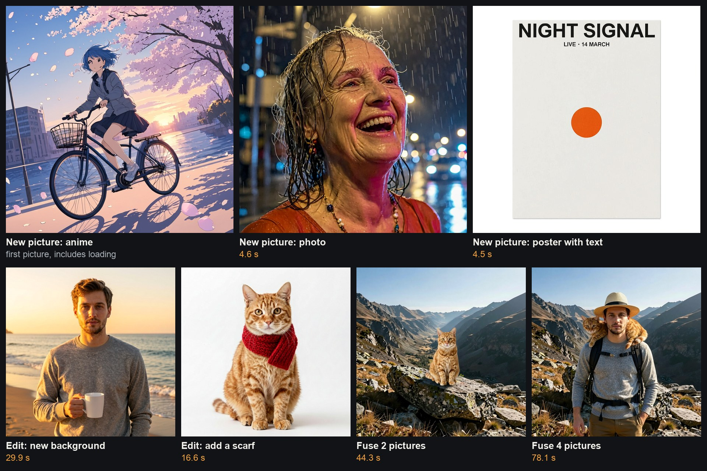

## The setup

- **Machine:** ASUS ProArt P16, NVIDIA RTX Spark, 128 GB of memory with 96 GB set aside for the graphics side.
- **Software:** ComfyUI 0.45.5, each model's **official ComfyUI template**. No custom settings, no LoRAs, nothing tuned. If you open the same template, you get the same thing I got.
- **Pictures:** 1024 × 1024 px, the same prompts for every model, and two fixed seeds (1001 and 2002), so one lucky or unlucky picture doesn't decide anything.
- **Timing:** seconds per picture once the model is loaded, measured with nothing else running on the machine. The first picture after loading a model is a bit slower.

## The tests

I wanted to test the three things people actually do with image models:

1. **Make a new picture from text.** Three prompts: an anime scene, a close-up photo of a person, and a poster with exact words on it.
2. **Edit a picture.** Change the background behind a person. Put a scarf on a cat. Everything else has to stay the same.
3. **Fuse several pictures into one.** Two pictures (a cat and a mountain), then four (a man, a cat, a mountain and a hat).

These are the input pictures for the edit and fuse tests:

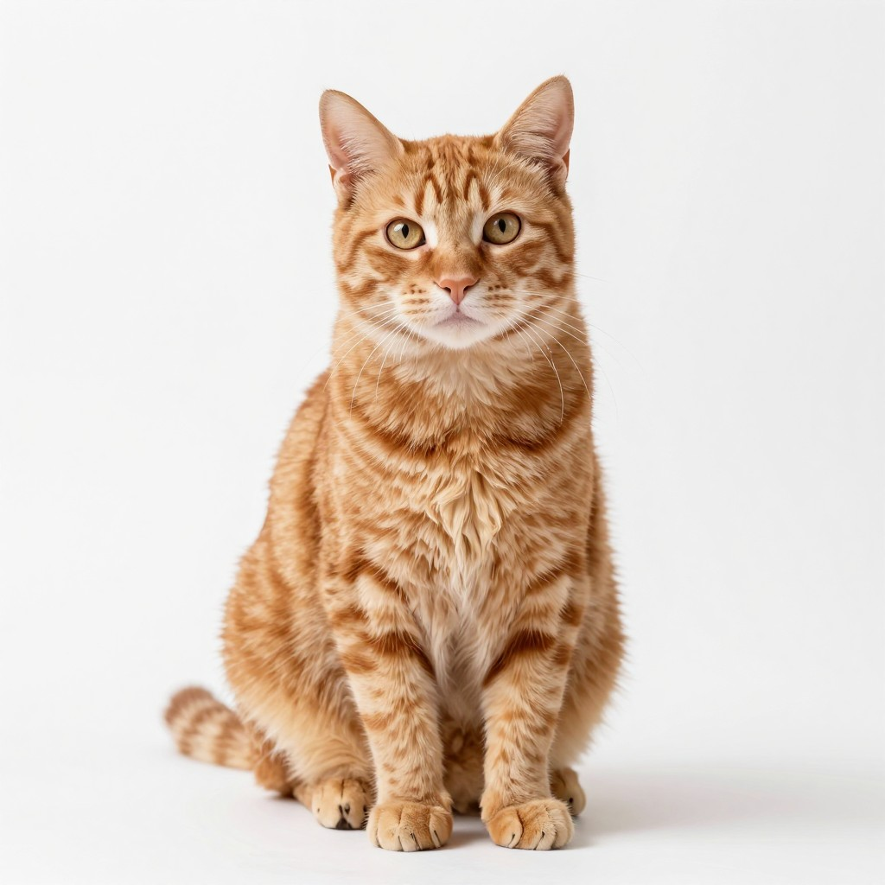
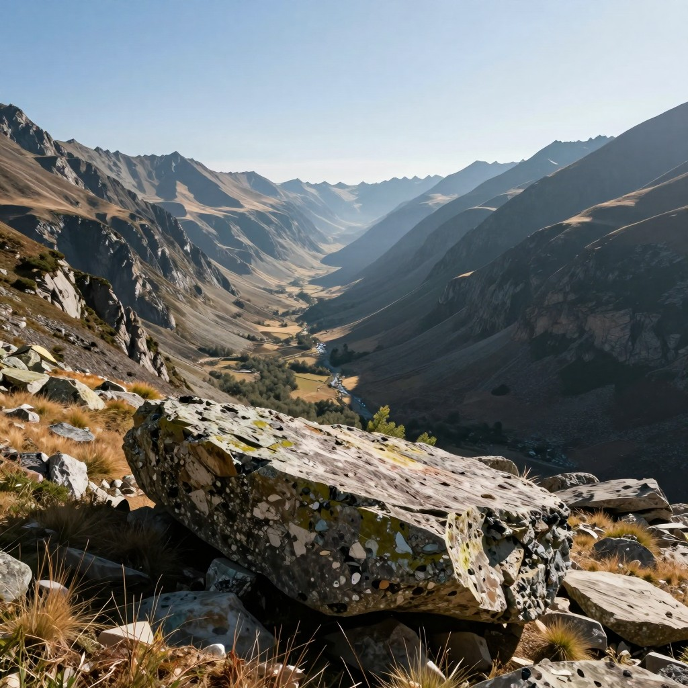
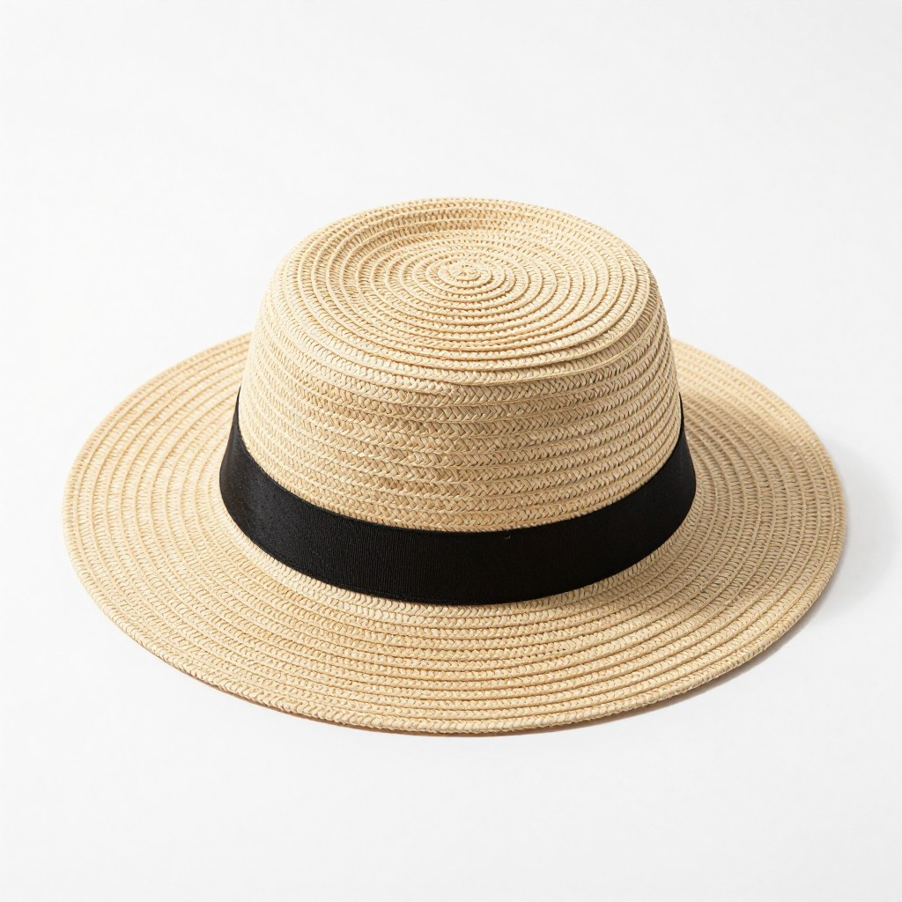

For each model I measured three things: the quality of the picture, how long it took, and how well it followed the instructions.

## The models

19 models, 23 builds in total. A "build" is the same model with a different setting or file, like Qwen with and without its 4-step Lightning add-on.

| Model | New picture | Edit | Fuse | Download | Smallest card it runs on |
|---|---|---|---|---|---|
| SDXL 1.0 | yes | no | no | 6.5 GB | 8 GB |
| Illustrious XL 2.0 (SDXL, anime) | yes | no | no | 6.5 GB | 8 GB |
| RealVisXL 5.0 (SDXL, photos) | yes | no | no | 6.5 GB | 8 GB |
| FLUX 3 Klein | yes | yes | yes | 10.2 GB | 8 GB |
| MOSS-Image | yes | yes | yes | 12.4 GB | 8 GB |
| FLUX.2 klein 4B | yes | yes | yes | 15.0 GB | 12 GB |
| Qwen-Image 2.1 | yes | yes | yes | 16.1 GB | 12 GB |
| Fibo 2.0 Edit | no | yes | yes | 16.4 GB | 12 GB |
| FLUX.2 klein 9B | yes | yes | yes | 17.2 GB | 12 GB (16 GB to edit) |
| Chroma1-HD | yes | no | no | 13.7 GB | 16 GB |
| Krea 2 Turbo | yes | no | no | 17.4 GB | 16 GB |
| Z-Image Turbo | yes | no | no | 19.3 GB | 16 GB |
| LongCat Image Edit | no | yes | no | 20.7 GB | 16 GB |
| HiDream-O1 | yes | yes | yes | 15.2 GB | 24 GB |
| Ming-Image 0.1 Design | yes | no | no | 24.2 GB | 24 GB |
| Qwen-Image 2512 | yes | no | no | 28.0 GB | 24 GB |
| Qwen-Image-Edit 2511 | no | yes | 2 or 3 pictures | 28.1 GB | 24 GB |
| MiniMax H3-Image (4-bit reader) | yes | yes | yes | 35.2 GB | 24 GB |
| FLUX.2 dev | yes | yes | yes | 66.4 GB | 48 GB |

"Download" is every file the template loads. "Smallest card" is for a new picture or a single edit; fusing pictures needs more (see below).

## What fits on your card

This was the part I really wanted to answer. A model can fit your card in three ways:

- **Fits fully:** every part of the model sits on the graphics card at once. Fastest.
- **Runs by swapping parts:** the text reader loads, does its job, steps aside, and then the image model loads. Think of it like a small desk: you put one book away before opening the next. ComfyUI does this by itself and it only costs a little speed.
- **Streamed from system RAM:** even the image model is too big for the card, so ComfyUI feeds it in from your computer's memory while it draws. It still works, just slower.

| Card | Fits fully | Runs by swapping parts |
|---|---|---|
| **8 GB** | none | SDXL, Illustrious XL, RealVisXL, FLUX 3 Klein, MOSS-Image |
| **12 GB** | SDXL, Illustrious XL, RealVisXL | FLUX.2 klein 4B and 9B, Qwen-Image 2.1, Fibo 2.0 Edit |
| **16 GB** | FLUX 3 Klein, MOSS-Image | Z-Image Turbo, Krea 2 Turbo, Chroma1-HD, LongCat |
| **24 GB** | FLUX.2 klein 4B and 9B, Qwen-Image 2.1, Fibo, Z-Image, Krea 2, Chroma, LongCat, HiDream-O1 | Ming-Image, Qwen-Image 2512, Qwen-Image-Edit 2511, MiniMax H3 (4-bit reader) |
| **32 GB** | Ming-Image, Qwen-Image 2512, Qwen-Image-Edit 2511 | MiniMax H3 (int8 reader) |
| **48 GB** | MiniMax H3 (4-bit reader) | FLUX.2 dev |
| **96 GB** | MiniMax H3 (int8 reader), FLUX.2 dev | |

Each card also runs everything from the rows above it.

How I worked this out: I took the size of every file each template loads and added the working memory I measured for each job. For the 8 GB row I didn't want to guess, so I capped the laptop to what an 8 GB card gives you and ran SDXL, FLUX 3 Klein and MOSS for real. All three worked, with ComfyUI swapping the text reader out. They're the only ones whose image model is small enough (5 to 5.5 GB) to leave room for the picture itself.

The thing is, **feeding in more pictures needs more memory.** Fusing 4 pictures with Qwen-Image 2.1 or MOSS needs a 24 GB card, even though a single edit runs on 8 or 12 GB. The full table per job is in [results/fit-per-card.md](results/fit-per-card.md).

## Results: making a new picture

Sorted fastest first. Each picture shows the time per picture and the smallest card that runs it.

### A photo of a person

> Close-up portrait of a 70-year-old Caucasian woman laughing in light rain on a city street at night, wet hair, neon reflections, shot on an 85mm lens, shallow depth of field.

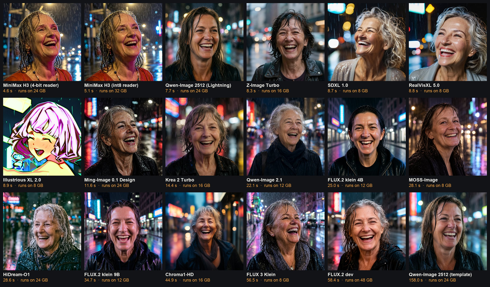

Most models made a good-looking photo. The interesting part is the age: several of them (FLUX.2 klein 4B and 9B, Qwen-Image 2512, Z-Image) made her look closer to 50 than 70. HiDream-O1, Qwen-Image 2.1, Chroma and the SDXL models got the age right.

### An anime scene

> Anime illustration of a girl with short blue hair riding a bicycle along a seaside road at sunset, cherry blossom petals in the air, clean cel shading.

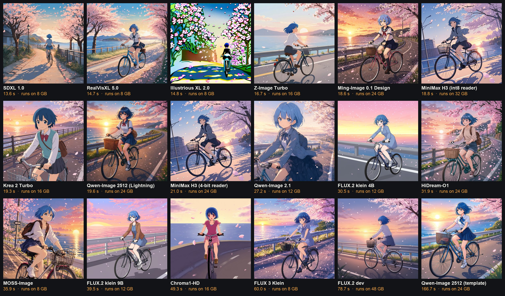

Almost every model handled this well. The odd one out was Illustrious XL, which is literally an anime model. With the plain SDXL template settings it came out broken, so it clearly needs its own settings. I'd treat that result as a settings problem, not the model.

### A poster with exact words

> A minimalist concert poster: the title 'NIGHT SIGNAL' in large bold letters at the top, 'LIVE · 14 MARCH' in smaller letters below it, a single orange circle in the centre, off-white paper background.

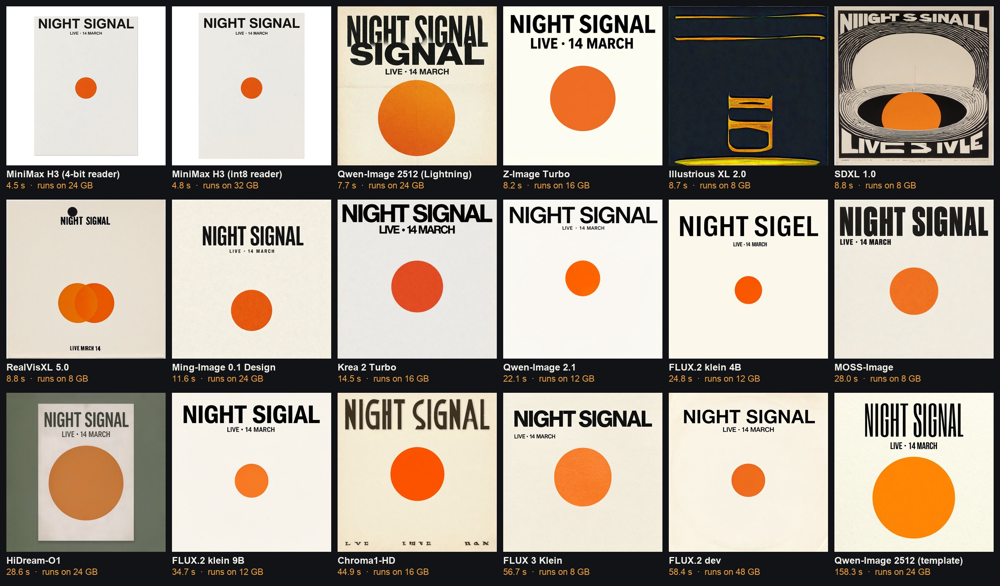

This is the hardest test for following instructions, because every letter has to be right.

- **Got it right:** MiniMax H3, Z-Image Turbo, FLUX 3 Klein, Qwen-Image 2.1, Qwen-Image 2512, Ming-Image, MOSS-Image, Krea 2, HiDream-O1, FLUX.2 dev.
- **Close but wrong:** FLUX.2 klein 4B ("NIGHT SIGEL"), FLUX.2 klein 9B ("NIGHT SIGIAL"), Qwen-Image 2512 with Lightning (wrote "SIGNAL" twice), Chroma (garbled small text).
- **Can't do text:** SDXL and its fine-tunes. That's expected for a 2023 model.

## Results: editing a picture

### New background, same person

> Replace the background with a sunny beach at golden hour. Keep the person exactly the same.

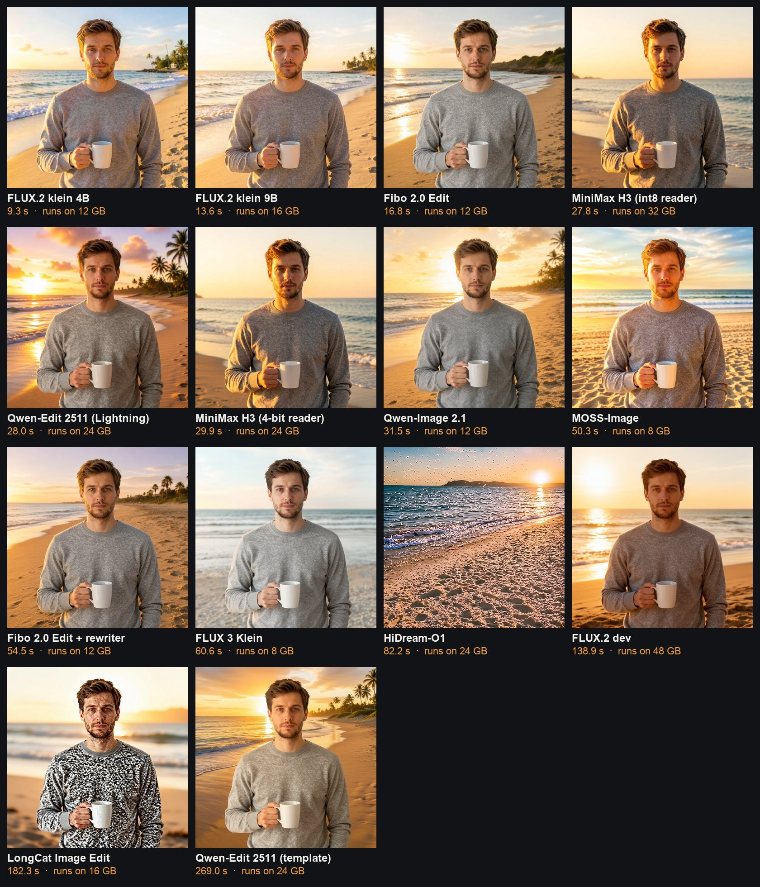

### Put a scarf on the cat

> Make the cat wear a small red knitted scarf. Change nothing else.

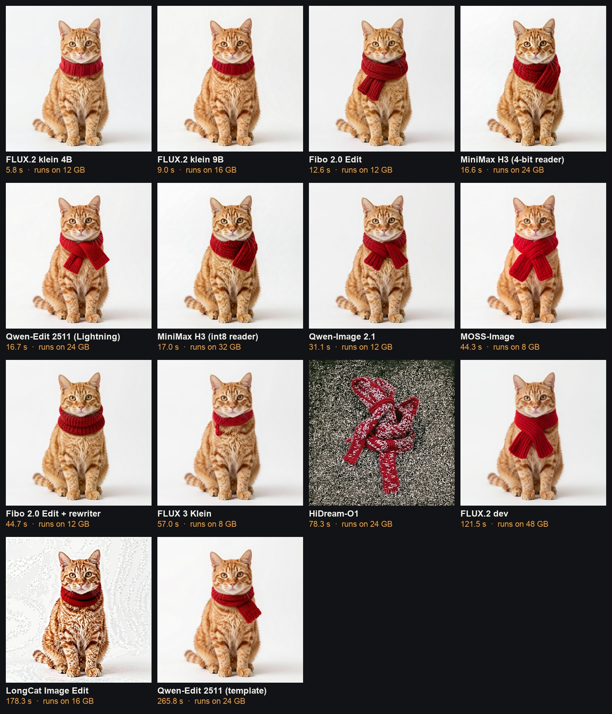

Most edit models kept the person and the cat exactly the same, which is the whole point. Two had problems: **HiDream-O1** returned noise instead of an edit on both seeds, and **LongCat** covered the picture in grainy noise on one of its two seeds (the other was clean). FLUX.2 klein 4B was the standout for speed: 7.5 s per edit.

## Results: fusing pictures

### Two pictures: the cat on the mountain

> Put the cat from image 1 sitting on the rock in the mountain valley from image 2.

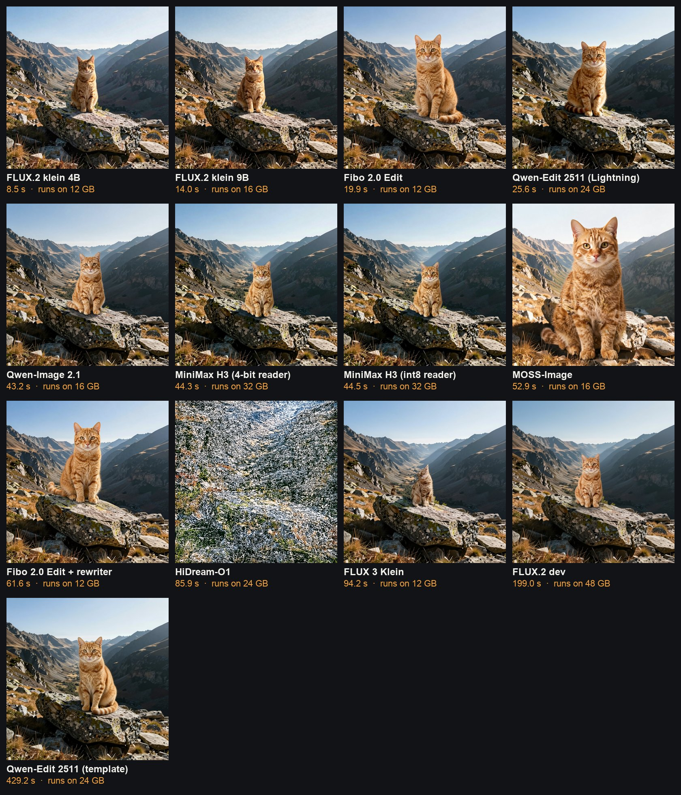

### Four pictures: man, cat, mountain and hat

> The man from image 1, wearing the hat from image 4, hiking in the mountains from image 3 with the cat from image 2 on his shoulder.

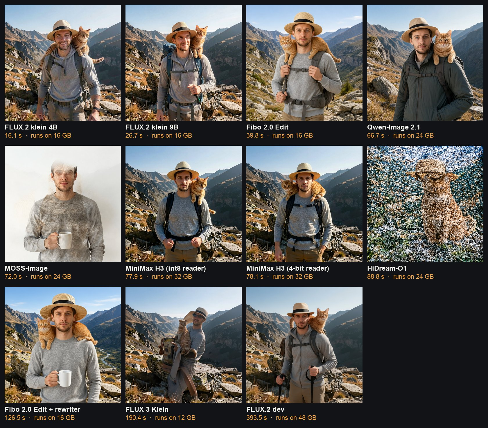

This one separates the models. MiniMax H3, FLUX.2 dev, FLUX.2 klein 4B and 9B, Fibo and Qwen-Image 2.1 all put the man, the hat and the cat in the mountains. MOSS-Image lost the scene completely, HiDream-O1 returned noise again, and Fibo with its prompt rewriter kept the mug from the original photo instead of making him hike.

## Speed

Seconds per picture after the model is loaded.

| Model | New picture | Edit | Fuse 2 | Fuse 4 |
|---|---|---|---|---|
| MiniMax H3 (4-bit reader) | 4.6 | 23 | 44 | 78 |
| Qwen-Image 2512 (Lightning) | 7.7 | | | |
| Z-Image Turbo | 8.3 | | | |
| SDXL / Illustrious / RealVisXL | 8.8 | | | |
| Ming-Image 0.1 Design | 11.6 | | | |
| Krea 2 Turbo | 14.5 | | | |
| Qwen-Image 2.1 | 22 | 31 | 43 | 67 |
| FLUX.2 klein 4B | 25 | 7.5 | 8.5 | 16 |
| MOSS-Image | 28 | 47 | 53 | 72 |
| HiDream-O1 | 29 | 80 | 86 | 89 |
| FLUX.2 klein 9B | 35 | 11 | 14 | 27 |
| Chroma1-HD | 45 | | | |
| FLUX 3 Klein | 57 | 59 | 94 | 190 |
| FLUX.2 dev | 58 | 130 | 199 | 394 |
| Qwen-Image 2512 (template) | 158 | | | |
| Fibo 2.0 Edit | | 15 | 20 | 40 |
| Fibo 2.0 Edit + rewriter | | 50 | 62 | 127 |
| Qwen-Image-Edit 2511 (Lightning) | | 22 | 26 | |
| LongCat Image Edit | | 180 | | |
| Qwen-Image-Edit 2511 (template) | | 267 | 429 | |

Every time for every run is in [results/results.csv](results/results.csv).

## What surprised me

- **Lightning add-ons are huge.** Qwen-Image 2512 went from 158 s to 7.7 s per picture with its 4-step Lightning file, and Qwen-Image-Edit 2511 from 267 s to 22 s. The tradeoff: the Lightning poster wrote "SIGNAL" twice.
- **The fastest model was also one of the best.** I expected MiniMax H3 to be slow because it's big. It was the fastest model in the test.
- **8 GB is more usable than I thought.** Five models run on it, because ComfyUI swaps the parts in and out by itself. You don't set anything.
- **Downloads slow everything down.** My first runs happened while models were still downloading and came out about 3 times slower. I re-ran every timing on a quiet machine.

## On a Mac?

These models also run on a Mac. NVIDIA cards are faster, and they're what these tools are built for, but it works. One thing to keep in mind when you read the card sizes: a 16 GB card here means the full 16 GB. A 16 GB Mac has less than that for the model, because macOS keeps a share for itself. So pick the next size up.

## What's in this repo

- `images/grids/`: the comparison grids from this page.
- `images/outputs/`: every output picture, both seeds (212 pictures).
- `images/inputs/`: the 4 input pictures.
- `workflows/`: the exact ComfyUI workflow for every single run. Drop one into ComfyUI and you get the same picture.
- `results/results.csv`: time and peak memory for every run.
- `results/fit-per-card.md`: which card each model needs, per job.
- `scripts/`: the scripts that ran the test, if you want to run it on your own machine.

## Limitations

- One machine. Speeds are from the RTX Spark in the ProArt P16. A desktop card will be faster or slower depending on the card.
- Official templates only. Some models (Illustrious XL for example) clearly do better with their own settings.
- The card sizes for 12 GB and up are worked out from the files plus measured working memory. Only the 8 GB row was capped and run for real.
- Two pictures per job. Enough to see the pattern, not enough to call a winner on a close race.
